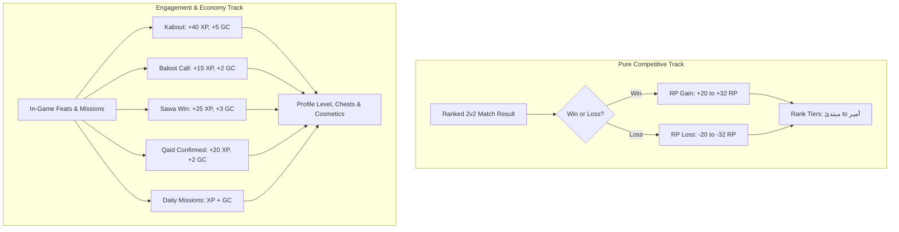
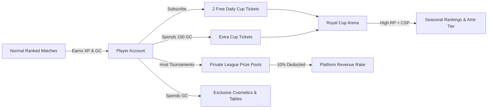

# Royal Baloot — Progression, Ranking & Economy Specification

**Document Version:** 2.0 (Executive Client Specification)  
**Project:** Royal Baloot  
**Target Client:** Visca ME (Mohamed)  
**Author:** Abdul Sami  
**Date:** October 2026  

---

## Executive Summary

This document presents the finalized, production-grade specification for **Royal Baloot's Progression, Ranking, and Economy Systems**.

Following detailed competitive analysis of established regional benchmarks (*Kammelna*) and strategic alignment with client objectives, this architecture establishes **absolute competitive integrity** while maximizing **daily retention and platform monetization**.

### Core Pillars
1. **Pure Skill RP Philosophy:** Rating Points (RP) represent genuine competitive skill alone. Luck-based card distributions (Kabout, Baloot) and gameplay utilities (Qaid, Sawa) are decoupled from RP and rewarded through a parallel **XP & Golden Cards** economy.
2. **2v2 Team Average Formula:** A mathematically balanced team-matching formula where both partners receive identical, fair RP adjustments based on the relative skill differential of the opposing team.
3. **Structured Tier Progression & High-Stakes Promotions:** 6 core tiers (3 sub-levels each) culminating in the prestigious **أمير 👑 (Amir)** rank, with high-stakes **Best-of-3 Promotion Series** at tier boundaries.
4. **Royal Cup as a Monetized Arena:** An exclusive, ticket-gated competitive mode with higher stakes (±35 RP), strict anti-farming daily caps, and unique seasonal leaderboards.
5. **Sustainable Dual-Currency Economy:** Player-hosted tournaments with built-in **10% platform rake**, highly competitive subscription pricing (20–32% below Kammelna), and cosmetic sinks that preserve a strict non-pay-to-win balance.

---

## 1. Competitive Architecture: Kammelna vs. Royal Baloot

| Domain | Kammelna Benchmark | Royal Baloot Specification | Strategic Advantage |
| :--- | :--- | :--- | :--- |
| **Rank Structure** | 6 levels, 5 sub-levels each (30 total) | **6 levels, 3 sub-levels each (18 total)** | Cleaner milestones, faster perceived progression, less visual clutter. |
| **Pinnacle Rank** | نابغة (Prodigy) | **أمير 👑 (Amir)** | Exclusive Royal Baloot branding; establishes aspirational royalty status. |
| **RP Logic** | Points swing heavily on wins/losses | **Team-Average Elo Delta (±20 Base)** | Mathematically fair for 2v2 pairs; removes partner griefing/disparity. |
| **In-Game Bonuses** | Mixed point grants | **Zero RP for luck; XP & Golden Cards instead** | Rank reflects skill, not lucky hands or grinding volume. |
| **Cup Mode** | 2 tickets/day for VIP, open farming | **Ticket-gated + Hard 4/day entry cap + 100 RP cap** | Prevents leaderboard buyouts and RP inflation by whales. |
| **Promotion Gates** | Direct point rollover | **Best-of-3 Promotion Series (free)** | Creates broadcast-worthy, high-tension milestone gameplay. |
| **Private Leagues** | VIP room creation | **VIP Host + GC Prize Pool + 10% Platform Fee** | Generates organic, passive platform revenue from player rivalries. |
| **Subscription Value** | Premium pricing (34.99 SAR/mo) | **Disruptive pricing (24.99 SAR/mo, 29% lower)** | Lowers barrier to entry; captures market share from day one. |

---

## 2. Match Rating Points (RP) Engine

To maintain competitive credibility, RP strictly measures a team's ability to win matches against opponents of known strength.

### 2.1 Standard Ranked Match Formula (2v2 Team Average)

Because Baloot is inherently a 2v2 cooperative game, matchmaking and point calculations evaluate **Team Average RP**, not individual player ranks. Teammates always win or lose the **exact same RP amount**.

```
Team A Average RP = (Player 1 RP + Player 2 RP) / 2
Team B Average RP = (Player 3 RP + Player 4 RP) / 2
Level Gap = Opponent Team Tier Index - My Team Tier Index   [Clamped: -3 to +3]
```

#### Base RP Matrix (Standard Ranked Play)

| Match Context | Team Tier Difference | RP on Victory | RP on Defeat |
| :--- | :---: | :---: | :---: |
| **Even Match** | Equal Level (Gap = 0) | **+20 RP** | **-20 RP** |
| **Underdog Win / Favorite Loss** | Opponents 1 Level Higher (+1) | **+24 RP** | **-24 RP** |
| **Significant Underdog** | Opponents 2 Levels Higher (+2) | **+28 RP** | **-28 RP** |
| **Maximum Upset** | Opponents 3+ Levels Higher (+3) | **+32 RP** *(Max Win)* | **-32 RP** *(Max Loss)* |

#### Win Streak Adjustments (Capped Form Factor)
To reward consistency without creating run-away inflation:
* **3–4 Consecutive Wins:** `+2 RP` bonus.
* **5+ Consecutive Wins:** `+4 RP` bonus *(Hard cap — prevents streak farming).*

#### Bot & Asymmetric Edge Cases
* **Bot Match:** Bots are benchmarked as Tier 0 (مبتدئ). Beating bots yields a flat **+5 RP**; losing to bots incurs **0 RP penalty**.
* **Mid-Game Disconnections:** The disconnecter receives full match loss penalty. The remaining innocent teammate suffers **half penalty** (-50%). Opponents receive standard win RP.

---

## 3. Pure Skill RP vs. Engagement Rewards

In early drafts, in-game actions like Kabout, Baloot declarations, Qaid, and Sawa rewarded RP. Under the finalized specification, these are **strictly removed from the RP engine** and routed to **XP and Golden Cards (GC)**.

### Rationale for Decoupling:
1. **Baloot Declaration (K+Q of Trump):** Pure card-deal luck. Awarding RP rewards random dealing rather than tactical mastery.
2. **Kabout (Grand Slam):** Heavily dependent on trump card dominance. Should be celebrated with coins/XP, not rank skewing.
3. **Qaid & Sawa:** Crucial tactical tools. If penalizing RP, players develop anxiety and avoid using them; if rewarding RP, they become exploited.
4. **Daily Missions:** Engagement tools meant to drive daily logins. Letting missions grant RP allows low-skill players to outrank superior players by sheer grinding time.

### The Two Parallel Tracks



---

## 4. Rank Tiers & Promotion Series

Players progress through **6 primary ranks**, subdivided into **3 sub-levels (I, II, III)**.

### 4.1 Rank Tier Table

| Tier # | Arabic Name | English Name | Required RP | Sub-Level I | Sub-Level II | Sub-Level III (Promo Zone) | Expected % of Player Base |
| :---: | :--- | :--- | :---: | :---: | :---: | :---: | :---: |
| **1** | **مبتدئ** | Beginner | 0 – 299 | 0 – 99 | 100 – 199 | 200 – 299 | ~35% |
| **2** | **متوسط** | Intermediate | 300 – 899 | 300 – 499 | 500 – 699 | 700 – 899 | ~28% |
| **3** | **متقدم** | Advanced | 900 – 1,799 | 900 – 1,199 | 1,200 – 1,499 | 1,500 – 1,799 | ~18% |
| **4** | **محترف** | Professional | 1,800 – 3,299 | 1,800 – 2,299 | 2,300 – 2,799 | 2,800 – 3,299 | ~12% |
| **5** | **خبير** | Expert | 3,300 – 5,999 | 3,300 – 4,299 | 4,300 – 5,299 | 5,300 – 5,999 | ~5% |
| **6** | **أمير 👑** | Amir | 6,000+ | 6,000 – 6,999 | 7,000 – 7,999 | 8,000+ *(Top 500 Hall)* | <2% |

### 4.2 Best-of-3 (BO3) Promotion Series

When a player reaches the top of **Sub-Level III** in any main tier, normal RP movement is temporarily frozen, and an automatic **Promotion Series** begins.

* **Eligibility:** Triggered automatically upon reaching the boundary. **100% Free** (no tickets or GC required).
* **Format:** Best-of-3 matches (first to 2 wins earns promotion; 2 losses fails).
* **RP Status During Series:** Frozen. Win and loss markers are tracked on screen.
* **Success Outcome:** Immediate promotion to Sub-Level I of the next rank tier at **0 RP into the new tier** + **Grand Chest awarded**.
* **Failure Outcome:** Player remains in the current rank, resetting to **70% of Sub-Level III** (requiring 2–3 standard wins to re-challenge the gate).

---

## 5. Royal Cup: Premium Competitive Arena

The **Royal Cup** is an elevated, ticket-gated arena operating in parallel with standard ranked play. It satisfies the high-stakes competitive itch of veteran players while establishing core subscription and currency utility.

### 5.1 Mechanics & Anti-Farming Protections

| Parameter | Standard Ranked Match | Royal Cup Arena | Anti-Farming Protection |
| :--- | :--- | :--- | :--- |
| **Entry Gating** | Free (Hearts system) | **1 Cup Ticket** | Subscriptions provide 2/day; extra tickets cost 100 GC. |
| **Daily Entry Cap** | Unlimited | **Max 4 entries / day** | Hard cap prevents whales from spamming matches. |
| **Base RP Stakes** | ±20 RP Base | **±35 RP Base (75% higher)** | High risk, high reward. |
| **Daily RP Cap** | Unlimited | **Max +100 RP gained / day** | Gains stop at +100 RP; losses continue to apply. |
| **Rank Gate** | None (All players) | **متوسط I (300 RP) Minimum** | Beginners cannot enter; protects matchmaking pool. |
| **Bots Allowed** | Yes (in low tiers) | **Strictly Real Players (0 Bots)** | Preserves authenticity and prestige. |
| **Secondary Reward** | Chest + XP | **Cup Season Points (CSP)** | Feeds exclusive seasonal Hall of Fame leaderboard. |

### 5.2 Cup Ticket Lifecycle
1. **Subscribers:** Receive **2 free tickets daily** at 00:00 UTC (use-it-or-lose-it within 24h).
2. **Golden Card Purchase:** Players may purchase up to 2 extra tickets/day at **100 GC each**.
3. **Weekly Mission:** Occasional mission completion awards 1 ticket.
4. **Hard Limit:** Under no circumstance may any player enter more than 4 Cup matches in a single 24-hour cycle.

---

## 6. Leagues, Tournaments & Platform Rake

To foster community-driven esports and monetize player rivalries, Royal Baloot offers a dual tournament system: **Player-Created Leagues** and **Official Admin Events**.

### 6.1 Player-Created Leagues (Community-Funded)
* **Hosting Requirements:** Active Subscription + Minimum 500 GC prize pool deposit.
* **Format Options:** 4, 8, 16, or 32 teams; Single Elimination, Double Elimination, or Swiss.
* **Entry Fees:** Custom buy-in set by host (0 to 200 GC per player).
* **10% Platform Revenue (Rake):**  
  The platform automatically retains **10% of every league prize pool**.  
  *Example:* A 16-player league with a 500 GC entry fee generates an **8,000 GC pool**.  
  The winners split **7,200 GC**, and Royal Baloot collects **800 GC passively** as system sink.

### 6.2 Official Royal Baloot Tournaments (Admin-Created)
* Managed directly via the Admin Dashboard.
* Scheduled weekly cups, monthly majors, and holiday specials.
* Gated by verified rank bands (e.g. *محترف to أمير only*) to ensure balanced tournament brackets.
* Rewards include massive GC pools, bespoke animated card backs, profile titles, and Hall of Fame honors.

---

## 7. Macro Economy & Monetization Ecosystem



### 7.1 Golden Cards (ورقة ذهبية) Economy Flow

#### How Players EARN Golden Cards:
* **In-Game Accolades:** Kabout (+5 GC), Sawa (+3 GC), Baloot (+2 GC), Qaid (+2 GC).
* **Daily / Weekly Missions:** 10–50 GC per completed tier.
* **Ranked Season Finish:** Tiered payouts (محترف: 100 GC | خبير: 200 GC | أمير: 500 GC).
* **Tournament Placements:** Tiered shares of the 90% prize pool.
* **IAP Store Bundles:** Primary direct revenue stream (Packs from $1.99 to $24.99).

#### How Players SPEND Golden Cards:
* **Cup Tickets:** 100 GC per ticket (max 2 extra/day).
* **Hosting Tournaments:** 500 GC minimum deposit.
* **Vanity Cosmetics:** Rare Card Backs (600 GC), Animated Backs (1,200 GC), Custom Tables (800 GC), Animated Avatar Frames (500 GC).
* **Social Gifts in Chat Lobby (اهداء):** 50 to 2,000 GC items displayed in public feed.
* **Heart Refills:** 50 GC for 5 hearts (free players).

### 7.2 Subscription Benchmarking vs. Market Leader (Kammelna)

To capture immediate market share, Royal Baloot subscriptions are priced **20% to 32% below Kammelna**:

| Billing Period | Royal Baloot (SAR) | Royal Baloot (USD) | Kammelna (SAR) | Value Advantage |
| :--- | :---: | :---: | :---: | :---: |
| **Weekly (أسبوعي)** | **9.99 SAR** | ~$2.99 | 12.99 SAR | **23% Cheaper** |
| **Monthly (شهري)** | **24.99 SAR** | ~$6.99 | 34.99 SAR | **29% Cheaper** |
| **Quarterly (3 أشهر)** | **64.99 SAR** | ~$17.99 | ~95.00 SAR | **32% Cheaper** |
| **Annual (سنوي)** | **199.99 SAR** | ~$54.99 | 289.99 SAR | **31% Cheaper** |

#### Complete Subscription Benefits:
1. **2 Daily Royal Cup Tickets** (Worth ~6,000 GC monthly).
2. **Full In-Game Qaid & Sawa Access** (Premium competitive controls).
3. **Unlimited Hearts** (Unrestricted normal ranked grind).
4. **100% Ad-Free Experience**.
5. **Private Social Lobby Chat Access** & Free Monthly Name Changes.
6. **Host Rights for Custom Leagues & Private Rooms**.

---

## 8. Retention Loops: Seasons, Decay & Chest Milestones

### 8.1 90-Day Ranked Seasons & Anti-Camping Decay
* **Season Cadence:** 90-day cycles with an end-of-season soft reset (**20% RP reduction** across all players).
* **Inactivity Rank Decay:** If an account plays zero ranked matches for **14 consecutive days**, it decays at **5 RP per day**. This prevents players from parking on leaderboard spots and drives active weekly engagement.

### 8.2 Chest Reward Cadence
* **Wood Chest:** Awarded every single match completed (small XP, hearts, chance of GC).
* **Silver Chest:** Guaranteed every **5 matches**.
* **Gold Chest:** Guaranteed every **15 matches**.
* **Grand Chest:** Guaranteed upon completing a **Best-of-3 Promotion** into a new main rank tier.

### 8.3 Lifetime Achievement Tracker ("Total Wins")
While RP fluctuates according to win/loss form, a permanent **"Total Wins"** counter is publicly visible on the user's profile. It never decreases, honoring time investment and unlocking permanent cosmetic badges and prestige frames.

---

## 9. Summary of Evolution from Previous 3-Page Draft

| Mechanic | Previous Draft Spec | Finalized Production Spec | Why the Change Was Made |
| :--- | :--- | :--- | :--- |
| **Top Rank Name** | نابغة (Prodigy) | **أمير 👑 (Amir)** | Distinct brand identity; reinforces Royal Baloot prestige. |
| **Kabout / Baloot** | +4 RP and +1 RP | **Removed from RP → Award GC & XP** | Card luck must never influence competitive ranking. |
| **Qaid / Sawa** | +2 RP each | **Removed from RP → Award GC & XP** | Eliminates hesitation; encourages natural tactical play. |
| **Mission Rewards** | Up to +25 RP | **Zero RP → Award GC & XP** | Prevents volume grinders from outranking skilled players. |
| **First Win of Day** | +3 RP | **+100 XP only** | Habit formation mechanism; not a rank determinant. |
| **Streak Bonus** | Scaled up to +8 RP | **Capped at max +4 RP** | Suppresses artificial win-streak rating inflation. |
| **Calculation Base** | Individual player Elo | **2v2 Team Average Elo** | Mathematically sound for 2v2 partner balance. |
| **Royal Cup** | Not integrated | **Fully Specified (+35/-35 RP, Caps)** | Core driver of subscription and tournament engagement. |
| **Leagues & Rake** | Not integrated | **10% Platform Rake on GC Pools** | Creates scalable, self-sustaining monetization. |

---

*This specification represents the complete, client-ready blueprint for the Royal Baloot Progression and Economy Engine.*
